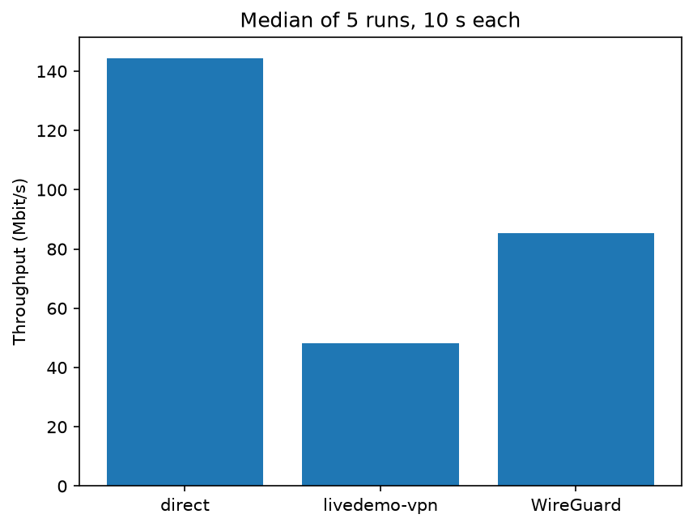

# LiveDemo VPN

A minimal VPN in ~200 lines of C, built to understand how tools like WireGuard work.
Client: macOS (`utun`). Server: Linux (`tun`). Learning project, not for real use.

## How it works

**Outgoing (app → internet)**

```
app (e.g. curl example.com)
 → Mac routing table sends the packet into utun (10.8.0.2)
 → livedemo-vpn reads it, encrypts it, adds a header
 → UDP :5555 over Wi-Fi to the server
 → livedemo-vpn verifies, decrypts, writes it into tun0 (10.8.0.1)
 → server forwards it, NAT swaps 10.8.0.2 for the server's public IP
 → ens5 → internet
```

**Incoming (internet → app)**

```
example.com replies to the server's public IP
 → NAT recognizes the connection and swaps the destination back to 10.8.0.2
 → server routes it into tun0
 → livedemo-vpn reads it, encrypts it, sends it over UDP to the Mac
 → livedemo-vpn on the Mac verifies, decrypts, writes it into utun
 → Mac kernel delivers it to the app
```

A single `poll()` loop on each side watches both the tunnel fd and the UDP socket, so one thread handles both directions.

## Quick start

```sh
gcc -O2 livedemo-vpn.c common.c -o livedemo-vpn $(pkg-config --cflags --libs libsodium)
gcc keygen.c -o keygen $(pkg-config --cflags --libs libsodium)
./keygen && chmod 600 vpn.key            # copy the same vpn.key to the server

sudo ./livedemo-vpn -s                   # server (open UDP 5555)
sudo ./livedemo-vpn -c SERVER_IP         # Mac
ping 10.8.0.1
```

## Design

- **UDP:** avoids TCP-over-TCP meltdown, and one datagram = one packet.
- **Portable:** `#ifdef __APPLE__` handles utun's 4-byte header.
- **Packet:** `[counter 8][nonce 24][ciphertext + tag 16]`, with MTU 1400.
- **Crypto:** XChaCha20-Poly1305 (libsodium). The header is authenticated but not encrypted.
- **Replay protection:** the receiver drops any counter it has already seen.

## Self-tests

Restart both ends before each test.

**Tamper:** flips one bit in every 10th packet.
```sh
sudo ./livedemo-vpn -c SERVER_IP --tamper
ping -c 30 10.8.0.1   # expect 10% loss; server shows bad_packets=3
```

**Replay:** sends every packet twice.
```sh
sudo ./livedemo-vpn -c SERVER_IP --replay
ping -c 30 10.8.0.1   # expect 0% loss, no (DUP!); server shows replays=30
```

## Results

Mac on Wi-Fi to EC2, all measured in one session. Throughput: median of 5 × 10 s `iperf3` runs (the three setups alternated each round). Latency: min RTT of `ping -c 50`.

| | Throughput | Min RTT |
|---|---|---|
| Direct | 144 Mbit/s | 112.9 ms |
| livedemo-vpn | 48 Mbit/s | 113.6 ms |
| WireGuard | 85 Mbit/s | 112.7 ms |



livedemo-vpn adds under 1 ms of latency but loses throughput to per-packet overhead: several system calls and copies per packet on one thread. WireGuard avoids much of this by batching packets (wireguard-go) or running in the kernel.

## Limitations

Pre-shared key (no handshake or forward secrecy), one client, no replay window, client restart requires a server restart, IPv4 only.

## What I learned

A VPN turned out to be simpler than I expected at its core: a tun device is just a network interface whose "wire" is a file descriptor, and the VPN is a loop that encrypts packets between it and a UDP socket. The hard parts were everything around that loop: routing (a missing host route makes the tunnel send its own packets into itself), NAT on the server, and getting nonces and replay counters right. Benchmarking showed the cost is per packet (system calls and copies), not encryption.

One surprise: after restarting only the client, 29 of 30 pings failed. The server still remembered the highest counter from the previous session, so it dropped every new packet as a replay until the counter passed the old value. The replay protection was working exactly as designed, which showed me why real VPNs use a handshake to start each session with fresh keys and counters.

I also learned that a VPN hides traffic from outer firewalls but not from the server's own: AWS only saw encrypted UDP on port 5555, while ufw saw the unwrapped TCP from the tunnel and dropped it until I allowed `tun0`.